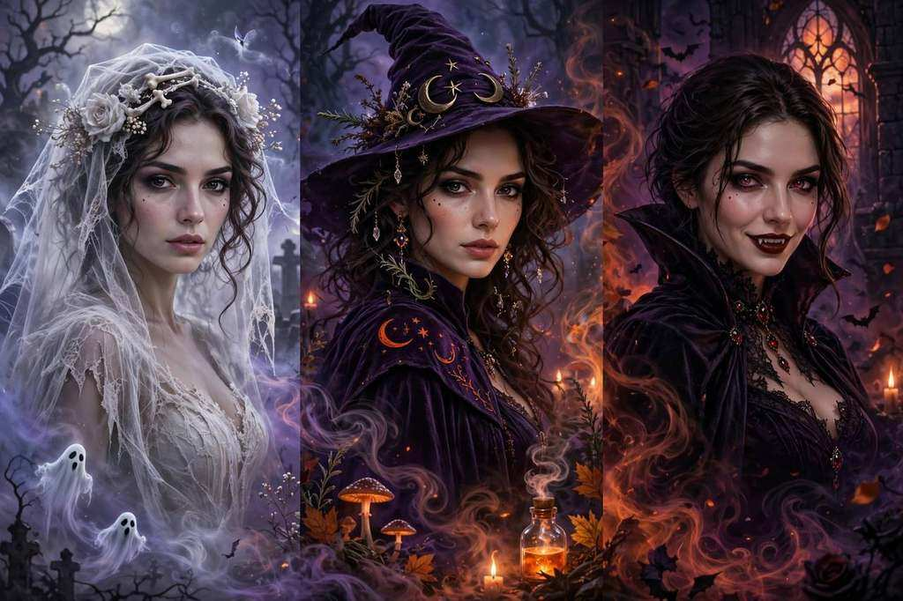

# Rumpelstiltskin AI Video Generator

**One photo. No prompt needed. Your tiptoe dance in an old-film fairy tale.**

一张照片 → Rumpelstiltskin tiptoe 舞蹈 AI 短片 · 复古胶片风 · 按秒付费

From **$4.99** · no subscription

Independent AI video fan tool — a new interpretation of the viral tiptoe meme, not a scene from the 1987 film. Upload only photos you have the rights to. When you share a realistic AI video, use the platform's AI disclosure controls.

## Links

|  | URL |
| --- | --- |
| **App** | https://rumpelstiltskinvideo.com |
| **This landing** | https://majiatools.github.io/rumpelstiltskin-ai/ |

## Demo

Trend references (not generated results — watch the tiptoe, the theatrical pause, and that old-film atmosphere):

- [Tiptoe dance reference](https://rumpelstiltskinvideo.com/references/tiptoe.mp4) — 16:9 / 10 sec
- [The barn scene](https://rumpelstiltskinvideo.com/references/barn.mp4)
- [A different cast](https://rumpelstiltskinvideo.com/references/duet.mp4)

## What it does

- **1 photo** → a tiptoe dance video with an intentionally old-fashioned look: straw barn, lantern light, velvet suit, visible film grain
- 3–15 seconds per video, **720p / 1080p / 4K**, 9:16 for social or 16:9 for the film look
- Per-second credits: 720p = 1/s, 1080p = 2/s, 4K = 6/s — cost shown before you generate
- Generated videos are silent — add music you are allowed to use
- Confirmed failures return your credits

## Pricing

| Pack | Price | Credits |
| --- | --- | --- |
| First take | $4.99 USD | 20 credits — up to 10s at 1080p |
| A few good takes | $12.99 USD | 80 credits — up to 40s at 1080p |
| The director's pack | $24.99 USD | 200 credits — up to 100s at 1080p |

One-time credit packs, no subscription.

## How to use

1. Open https://rumpelstiltskinvideo.com
2. Upload one clear photo (waist-up or full-body, even lighting; JPG/PNG/WebP, up to 10 MB)
3. Choose framing, length and resolution, generate, and download the MP4 from My videos

## License

Demo media for product showcase. Site © lynsea.
